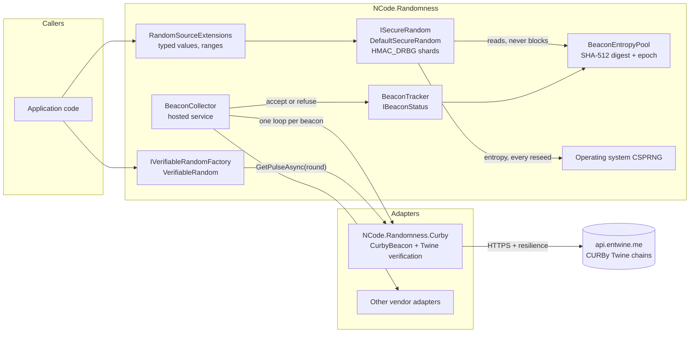

# Architecture

How NCode.Randomness is built. [assurance-case.md](assurance-case.md) explains why the design meets its security
requirements.

## Components

| Component | Role |
| --- | --- |
| `IRandomSource`, `ISecureRandom` | The byte-source port, and the capability that its bytes are secret. |
| `RandomSourceExtensions`, `Sampling/UniformSampler` | Every typed value and range over any source, unbiased and deterministic given the bytes, written once. |
| `SystemRandomSource` | The operating system's CSPRNG as an `ISecureRandom`, for use without DI or beacons. |
| `Generation/HmacDrbg` | NIST SP 800-90A HMAC_DRBG with HMAC-SHA-512, pinned to the CAVP vectors. |
| `Generation/DefaultSecureRandom`, `DrbgShard` | The registered `ISecureRandom`: per-processor shards, buffered, reseeded on a new pulse, on time and on volume ([ADR-1001](decisions/1001-the-secure-generator-is-a-sharded-buffered-hmac-drbg-reseeded-from-the-operating-system.md)). |
| `Entropy/BeaconEntropyPool` | Folds every accepted pulse into one digest and epoch that shards read without blocking. |
| `Hosting/BeaconCollector`, `BeaconTracker` | Fetch each beacon on its own loop; accept a pulse or refuse it for rollback, equivocation or staleness; keep each beacon's state ([ADR-1002](decisions/1002-beacons-are-adapters-collected-in-the-background-and-an-outage-degrades-never-fails.md)). |
| `IRandomnessBeacon`, `BeaconPulse`, `BeaconException` | The port a vendor adapter implements, its verified output and its failures ([beacon-adapters.md](beacon-adapters.md)). |
| `Draws/VerifiableRandom`, `IVerifiableRandomFactory` | Reproducible draws, `ncode-randomness-draw/1` ([draws.md](draws.md)). |
| `HealthChecks/BeaconHealthCheck` | Reports a beacon outage as `Degraded`. |
| `NCode.Randomness.Curby` | The CURBy adapter: the Twine HTTP client and the verification of chains and pulses ([ADR-1003](decisions/1003-curby-pulses-are-verified-against-a-pinned-chain-before-any-byte-is-used.md), [ADR-1005](decisions/1005-twine-verification-is-implemented-in-the-adapter-without-an-ipld-dependency.md)). |

## Design Rules

- Secrets come only from `ISecureRandom`, whose security never depends on a beacon
  ([ADR-1000](decisions/1000-beacon-randomness-is-mixed-into-a-local-generator-and-never-used-alone-for-secrets.md)).
- A caller never waits on the network: beacons are collected in the background, and a beacon outage degrades and never
  fails ([ADR-1002](decisions/1002-beacons-are-adapters-collected-in-the-background-and-an-outage-degrades-never-fails.md)).
- An adapter returns only verified pulses, against a trust anchor it pins.
- The sampling algorithms are a published contract: a change that alters the bytes they read is a new draw algorithm
  ([ADR-1004](decisions/1004-reproducible-draws-are-a-versioned-specified-algorithm-and-never-a-secure-random.md)).
- Decisions the design rests on are recorded in [decisions/](decisions/README.md).
- Warnings are errors ([ADR-0100](decisions/project-template/0100-warnings-are-errors-in-every-project.md)), and
  disallowed APIs are banned at build time
  ([ADR-0102](decisions/project-template/0102-disallowed-apis-are-banned-at-build-time.md)).
- The public API is tracked and evolves compatibly
  ([ADR-0131](decisions/project-template/0131-public-api-is-tracked-and-evolves-compatibly.md)), and each package is
  validated against the last published package
  ([ADR-0147](decisions/project-template/0147-packages-are-validated-against-the-last-published-package.md)).

## Build and Release

CI runs the project's commands on every pull request
(`.github/workflows/ci.yml`). Releases are tagged and published as
[ADR-0016](decisions/project-template/0016-releases-are-tagged-and-published-when-their-pull-request-merges.md)
records. `publish.yml` tests and packs the tagged commit, pushes to nuget.org through trusted publishing once a
maintainer approves the `nuget` environment, and calls `release-provenance.yml` and `raise-baseline.yml`
([ADR-0137](decisions/project-template/0137-the-release-workflow-starts-package-publishing.md),
[ADR-0151](decisions/project-template/0151-release-follow-ups-are-jobs-publish-calls.md)).
